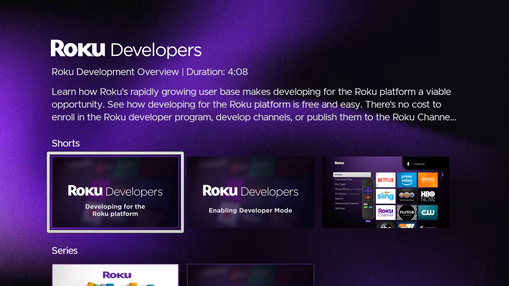
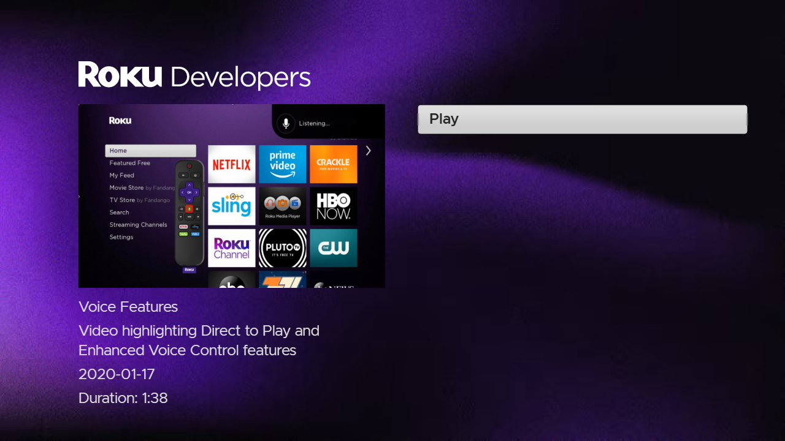
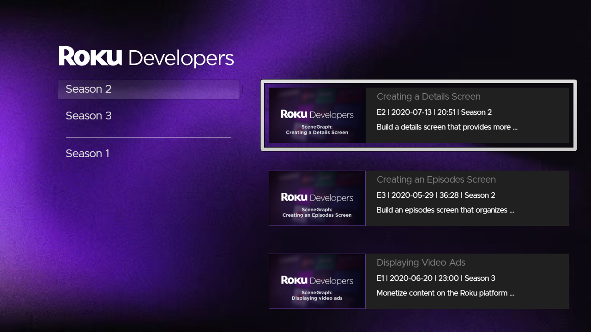

# roku-tv-app

A simple test Roku channel app written with SceneGraph (XML) and BrightScript. 

## Screens

**Home** — rows of posters (Shorts, Series, Videos) with a title and a short description at the top.



**Details** — large poster, title, description, release date, duration and a Play button.



**Seasons & Episodes** — season list on the left, episodes of the selected season on the right.



## Project structure

```
components/   SceneGraph components: screens, list items, UI logic, feed loader task
source/       shared BrightScript helpers (utils.brs)
images/       logos, focus frames, splash and icon artwork
manifest      channel manifest (HD 1280x720)
```

## Running

Enable developer mode on the Roku device (or launch the Roku desktop simulator), then
side-load the project as a zip: zip the contents of this folder (not the folder itself)
and install the resulting `zip` with the device's dev installer.
